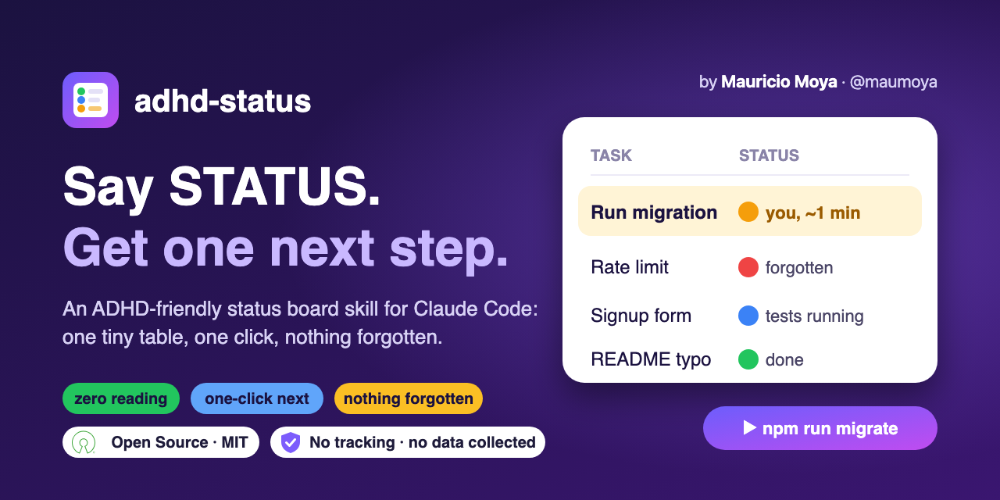

<p align="center">
  
</p>

<p align="center">
  
  
  
</p>

# adhd-status

**The ADHD-friendly status board for Claude Code and AI coding agents.** Say `STATUS`, get one
tiny table and one next step. Built for focus, executive function and context management.

A skill for Claude Code (and other agents that read `SKILL.md` skills) that turns **STATUS** into
a zero-reading status board.

Say `STATUS` in any working session and you get:

- one tiny **Task | Why | Status** table (4 rows max, plain words, emoji status, time estimates on
  your-turn rows, wins shown as ✅)
- exactly **one** next action you can click or run
- nothing forgotten: the agent sweeps the whole conversation with the `unlazy` skill first, so
  promised-but-dropped work shows up as a row
- no "paste the output" or "tell me when done": the agent checks results itself
- **one task per thread**: new work goes to a new thread; a finished thread reports back to its
  parent thread, then compacts and closes
- **hub mode**: a `ROADMAP.md` file is the summary page of every task in flight. One hub thread
  keeps it (your existing roadmap thread if you have one, else the root thread); child threads
  update only their own row when they hand back; STATUS in the hub thread shows the top 4 rows
- a nudge to compact (at a milestone, never mid-fix) or start fresh when the conversation gets long

Built for ADHD brains, useful for anyone juggling several things in one session.

See [`examples/status-reply.md`](examples/status-reply.md) for a sample reply.

## Install

### Full kit, one command (recommended)

Installs adhd-status plus its required companion [`unlazy`](https://github.com/Leonxlnx/unlazy)
as personal skills, linked so `git pull` updates them:

```bash
mkdir -p ~/src ~/.claude/skills && git clone https://github.com/maumoya/adhd-status.git ~/src/adhd-status && git clone https://github.com/Leonxlnx/unlazy.git ~/src/unlazy && ln -s ~/src/adhd-status/skills/adhd-status ~/.claude/skills/adhd-status && ln -s ~/src/unlazy ~/.claude/skills/unlazy
```

Restart Claude Code (or start a new session), then say `STATUS`.

### As a Claude Code plugin

```
/plugin marketplace add maumoya/adhd-status
/plugin install adhd-status@adhd-status
```

### As a plain skill

Claude Code loads personal skills from `~/.claude/skills/`.

```bash
git clone https://github.com/maumoya/adhd-status.git ~/src/adhd-status
ln -s ~/src/adhd-status/skills/adhd-status ~/.claude/skills/adhd-status
```

The symlink means `git pull` updates it. To copy instead, copy the `skills/adhd-status` folder to
`~/.claude/skills/`. For one project only, put it in that project's `.claude/skills/`.

### Companion: unlazy (required)

The status sweep runs the [`unlazy`](https://github.com/Leonxlnx/unlazy) skill so nothing is
missed. Install it the same way, as `~/.claude/skills/unlazy/`. Until you do, adhd-status uses a
built-in checklist and shows a row reminding you to install it.

## Use

Type any of these in a session:

```
STATUS
status?
where are we
what's left
```

## Tip: keep the board through compaction

Add this line to your project's `CLAUDE.md` so a `/compact` keeps what the board needs:

```
Compact instructions: keep every open task, its status, any command given to me, and the parent thread this one reports to.
```

## Test it (benchmark)

The `evals/` folder holds test cases in the format `claude plugin eval` reads. From this folder:

```bash
claude plugin eval .
```

It runs each case with and without the skill and reports the score difference. These are real
model runs and are billed to your account.

## Credits

- Time estimates, visible wins and the no-preamble rule are inspired by
  [i-have-adhd](https://github.com/ayghri/i-have-adhd) by Ayoub G. (MIT). It pairs well with this
  skill if you want every reply ADHD-shaped, not just STATUS.
- The completion sweep uses [unlazy](https://github.com/Leonxlnx/unlazy) (MIT).

## License

MIT. Copyright (c) 2026 Mauricio Alonso Moya Tapia.
